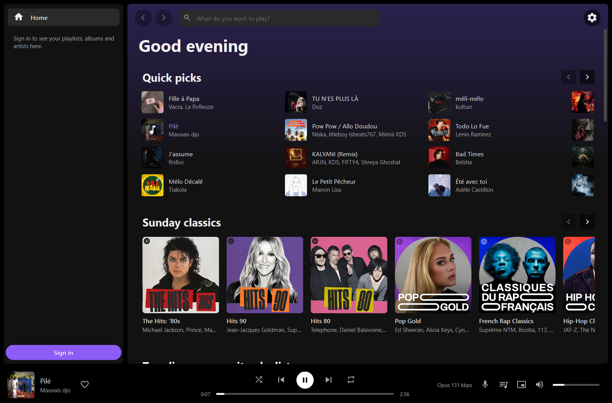
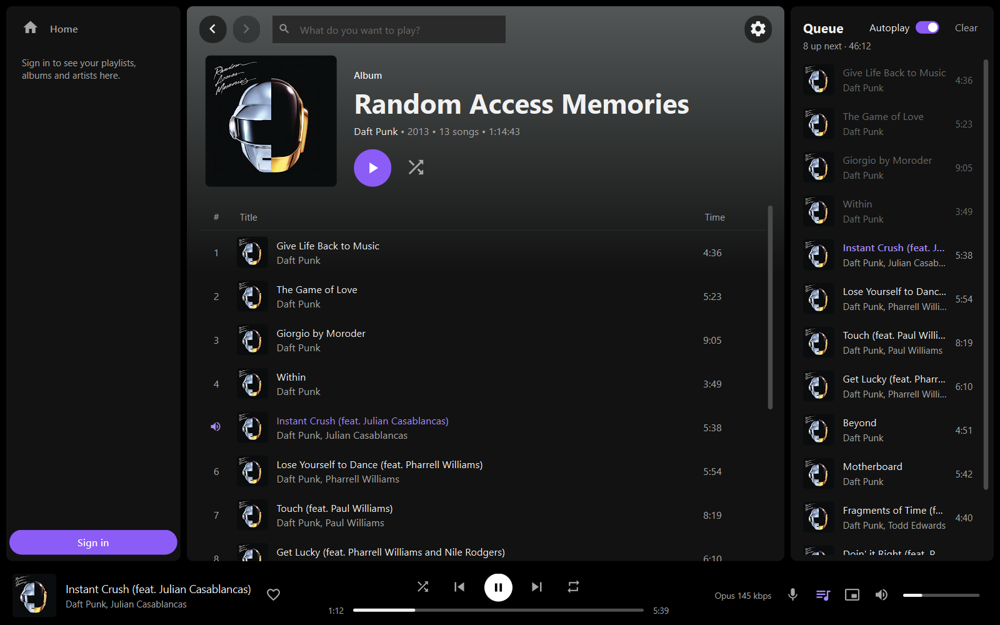
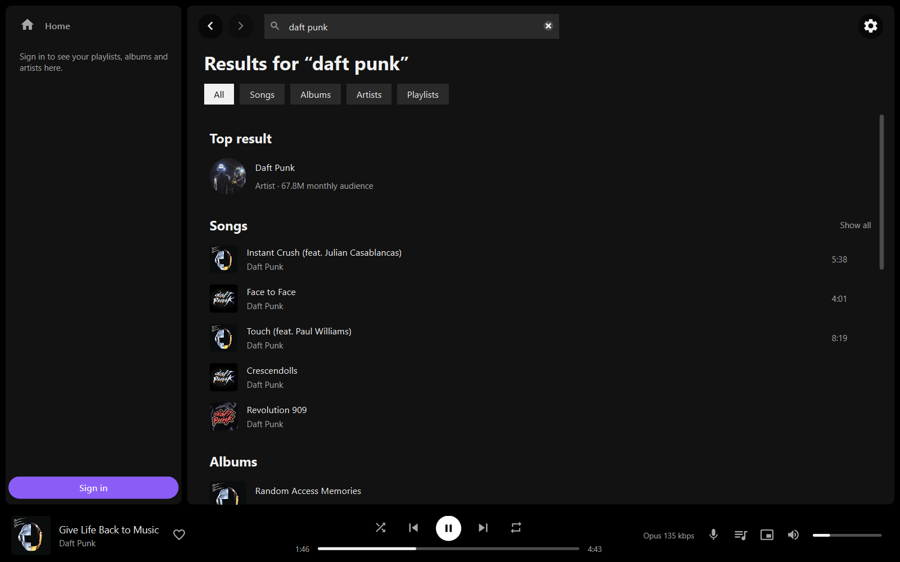
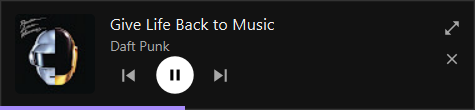
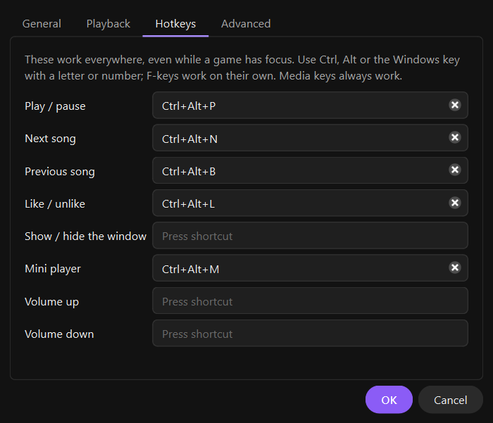
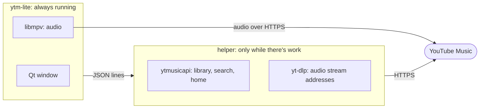

<div align="center">


# ytm-lite

**A lightweight YouTube Music player for Windows, built to run next to RAM-hungry games.**

A native Qt window and libmpv for the sound, with no browser inside.<br>
About 70 MB of RAM while it plays from the tray, 0.6 s to start.

**[Download for Windows](https://github.com/AntsXD/ytm-lite/releases/latest)** · [Run from source](#run-from-source)

[](https://github.com/AntsXD/ytm-lite/releases/latest)


[](LICENSE)



</div>

## Why ytm-lite?

On a desktop, YouTube Music is a browser tab or an app built around one, which keeps a whole web
browser running to play songs. ytm-lite is a small native player made for listening while a game
wants every megabyte: closing its window gives back what the window used, the YouTube work
happens in a helper process that exits when it's done, and the music keeps going from the tray.

| 💤 Idle in the tray | 🎵 Playing from the tray | 🪟 Playing, window open | 🚀 Cold start |
|:---:|:---:|:---:|:---:|
| **4–14 MB** | **58–70 MB** | **~150 MB** | **0.6 s** |

Measured on the packaged app as the Windows working set of all its processes: in the tray signed
in and signed out, with the window open signed out and a 460-song playlist on screen (a big
signed-in library adds a few MB). Task Manager's Memory column shows less, because it leaves out
memory shared with other programs. Playing from the tray takes under 2% of one CPU core, and
songs change without a gap.
[How it's measured, and every number so far](docs/MEASUREMENTS.md).

## Features

### 🎧 Listening

- **Premium quality** (Opus, ~256 kbps) when you sign in with a Premium account. The song you
  click starts in about 1.5 s; the ones after it are fetched in Premium quality while it plays.
- **Gapless playback.** The next song is loaded before the current one ends.
- **A real queue**: drag to reorder, Play next, Add to queue, shuffle, repeat, and Autoplay,
  which adds radio picks before the queue runs out.
- **Lyrics** beside the music, synced line by line when YouTube has timed lyrics. Click a line
  to jump to it.
- **Volume normalization** that works like YouTube Music's (loud songs are turned down by the
  loudness YouTube measured for them), or one that evens out loud and quiet parts. You can also
  pick the output device.

### 🔎 Finding music

- **Home** is your YouTube Music feed (Quick picks, mixes, new releases) as shelves of big
  covers that scroll sideways. Hover a cover and press play.
- **Search** suggests as you type, then shows the top result, songs, albums, artists and
  playlists, each with its own tab.
- **Album, artist and playlist pages**, your library in the sidebar, likes, and a radio from any
  song.

### 🖥️ On your desktop

- **Plays from the tray.** Closing the window frees it; one click brings it back on the page you
  left.
- **A mini player** that stays on top of other windows.
- **Media keys and the Windows media overlay**, with the cover, the position and the controls.
- **Global hotkeys** that work while a game has focus.
- **Picks up where you left off**: the queue, your place in it, the volume and the layout.

### 🔒 Your account

- **Sign in once** by importing from Firefox, or don't sign in at all: search and playback work
  without an account.
- **Credentials stay encrypted** with Windows DPAPI. They're never written in plain text or
  logged.
- **Your plays count.** Songs go into your YouTube Music history, so they shape your
  recommendations and your Recap. You can turn this off.
- **No telemetry.** ytm-lite talks only to YouTube and Google.
- **Survives YouTube's changes.** yt-dlp updates itself from PyPI, checksum-verified, without a
  new release of the app.

## Screenshots

<table>
  <tr>
    <td width="50%" align="center"><br><sub>An album, with the queue beside it</sub></td>
    <td width="50%" align="center"><br><sub>Search</sub></td>
  </tr>
  <tr>
    <td align="center"><br><sub>The mini player stays on top</sub></td>
    <td align="center"><br><sub>Global hotkeys, in Settings</sub></td>
  </tr>
</table>

## Getting started

### Download

Get the `windows-x64.zip` from the
[latest release](https://github.com/AntsXD/ytm-lite/releases/latest), unzip it anywhere and run
`ytm-lite.exe` (Windows 10 or 11, 64-bit). Everything it needs is in the folder: no installer,
no Python.

- The app isn't code-signed, so Windows may warn the first time ("Windows protected your PC"):
  choose **More info**, then **Run anyway**. If Smart App Control blocks it, run it from source
  instead.
- The first start adds **ytm-lite** to the Start menu, which is how Windows knows its name and
  icon in the media overlay. Settings, your sign-in and caches go to `%LOCALAPPDATA%\ytm-lite`.
  To remove the app, delete its folder, that one and the Start menu entry.

### Run from source

You need Windows 10 or 11, Python 3.11 or newer and
[uv](https://docs.astral.sh/uv/getting-started/installation/).

```bash
git clone https://github.com/AntsXD/ytm-lite.git
cd ytm-lite
uv sync
uv run python tools/fetch_libmpv.py    # the audio engine: a pinned libmpv build, checksum-verified
uv run python -m ytm_lite
```

On Linux, install libmpv from your package manager instead of running `fetch_libmpv.py` (see
the [FAQ](#faq)).

### Build the app yourself

`tools/build.py` makes the folder the release zips up, in `dist/ytm-lite/`, with Qt, libmpv,
Python and Deno inside. It needs Visual Studio's C++ build tools and takes about two minutes:

```bash
uv sync --group build
uv run python tools/build.py --zip
```

[Development](docs/DEVELOPMENT.md#build-the-windows-package) has the details.

## Signing in

The first start asks you to sign in. Three ways:

- **Import from Firefox** (simplest). Reads only the youtube.com cookies of your Firefox
  profile's default container, from a temporary copy of its cookie database that is deleted
  right after. If YouTube later rejects the session (Firefox rotates its cookies), the app
  quietly re-reads them before asking you to sign in again.
- **Paste headers.** Open a private window, sign in at music.youtube.com, press F12 → Network,
  filter on `browse`, and copy a request's headers (Firefox: Request Headers → Raw; Chrome/Edge:
  right-click → Copy as cURL (bash)). Close the private window afterwards so the browser can't
  rotate the copied cookies.
- **cookies.txt** (advanced): a Netscape-format export of a signed-in YouTube session.

Whichever you use, the Premium account should be the browser's default Google account (yt-dlp
always uses account index 0). Credentials are checked with YouTube before anything is saved,
stored encrypted with Windows DPAPI (an owner-only file elsewhere), and handed to the worker in
memory. "Continue without signing in" still lets you search, open albums and artists and play
anything in standard quality; your library and likes need a sign-in.

## Keyboard shortcuts

| Keys | Action |
|---|---|
| <kbd>Space</kbd> | Play / pause |
| <kbd>Ctrl</kbd>+<kbd>→</kbd> · <kbd>Ctrl</kbd>+<kbd>←</kbd> | Next · previous |
| <kbd>Ctrl</kbd>+<kbd>L</kbd> | Like the song that's playing |
| <kbd>Ctrl</kbd>+<kbd>F</kbd> | Search |
| <kbd>Alt</kbd>+<kbd>←</kbd> · <kbd>Alt</kbd>+<kbd>→</kbd> | Back · forward (the mouse's side buttons too) |
| <kbd>Ctrl</kbd>+<kbd>M</kbd> | Mini player |
| <kbd>Ctrl</kbd>+<kbd>,</kbd> | Settings |
| <kbd>Ctrl</kbd>+<kbd>Shift</kbd>+<kbd>D</kbd> | Debug overlay: memory, stream format, gaps between songs |
| <kbd>Ctrl</kbd>+<kbd>Q</kbd> | Quit |

**Global hotkeys** work while another app or a game has focus. Set them in Settings → Hotkeys
for play/pause, next, previous, like, showing the window, the mini player and volume. They use
Windows' RegisterHotKey, not a keyboard hook, so they don't sit between you and every key you
press.

<details>
<summary><b>More tips</b></summary>
<br>

- Double-click a song to play it; the rest of the list becomes the queue. Songs started from
  Home or from search are followed by their radio, so the music keeps going.
- Right-click a song (or a selection) for Play, Play next, Add to queue, Start radio, Go to
  album, Go to artist, Like and Copy link.
- In the queue, drag songs to reorder them, <kbd>Delete</kbd> removes the selection and a
  double-click jumps to a song.
- Click the tray icon to bring the window back, or middle-click it to play or pause. Its menu has
  Play/Pause, Next, Previous, Mini player, Settings and Quit.
- Drag the mini player anywhere; double-click it to get the full window back. The full window is
  closed meanwhile, so it costs next to nothing.
- Settings has four tabs. General: closing to the tray, Autoplay, adding plays to your history.
  Playback: normalization and the output device. Hotkeys. Advanced: the JavaScript runtime,
  yt-dlp's player clients, and the yt-dlp version with Check for update.
- Starting ytm-lite again brings up the running copy. `--play-pause`, `--next` and `--previous`
  are passed to the running copy (handy for a hotkey tool or a script), and `--start-minimized`
  starts in the tray without a window.
- The queue, your place in it (paused), shuffle, repeat, the volume and the window layout come
  back at the next start.

</details>

## Privacy and security

- ytm-lite talks only to YouTube and Google servers (the YouTube Music API, the audio servers,
  cover images). It has no telemetry and listens on no network port; the single-instance channel
  is a local pipe only your Windows user can open, and it accepts four commands.
- Everything goes over HTTPS with certificate checks, including the audio streams: mpv doesn't
  check certificates unless told to, so the app turns that on and gives it certifi's CA bundle
  (the Windows libmpv build's OpenSSL has no store of its own). The stream requests carry no
  cookies.
- Premium streams need YouTube's JavaScript challenge solved. yt-dlp runs it in Deno with no
  file, network or environment permissions.
- yt-dlp updates come from PyPI over HTTPS. Both files must match PyPI's SHA-256, may only unpack
  inside their own folder, and the new yt-dlp must import before the worker switches to it; the
  copy that came with the app stays as the fallback.
- Your cookies are as good as being signed in to YouTube. DPAPI keeps them from other Windows
  users and from anyone who takes the disk, not from malware running as you (Firefox keeps the
  same cookies unencrypted in its profile).

## FAQ

<details>
<summary><b>Can my account get banned for using it?</b></summary>
<br>

ytm-lite is an unofficial client: YouTube's terms cover its own apps, and yt-dlp's maintainers
warn that an account used with yt-dlp can be banned, depending on request rate and download
volume. ytm-lite asks for one stream per song you play (plus the next one, ahead of time) and
downloads nothing to disk, and the song you start yourself is resolved without your account.

</details>

<details>
<summary><b>Do songs I play here count for my history, recommendations and Recap?</b></summary>
<br>

Yes, when you're signed in. After 10 seconds of a song (pauses don't count), ytm-lite adds it to
your YouTube Music history the way YouTube Music's own player does. Settings → General turns this
off.

</details>

<details>
<summary><b>Do I need YouTube Premium?</b></summary>
<br>

No. Without an account you can search and play anything in standard quality (Opus, ~134 kbps).
Signing in adds your library, playlists and likes; with Premium, songs come in Premium quality
(Opus, ~256 kbps).

</details>

<details>
<summary><b>What happens when YouTube changes something and songs stop playing?</b></summary>
<br>

That happens every few weeks, and yt-dlp keeps up with it. When songs keep failing, a banner
offers "Check for yt-dlp update" (it's also in Settings → Advanced): the helper process downloads
the newest yt-dlp from PyPI, checks it, and switches to it while the current song keeps playing.

</details>

<details>
<summary><b>Why Python? Isn't that heavy?</b></summary>
<br>

The heavy lifting isn't done in Python: Qt draws the window and libmpv plays the audio, in C++
and C. Python ties them together, and the Python libraries that talk to YouTube (yt-dlp and
ytmusicapi, 60–85 MB) live in a separate process that only runs while it has work to do. The
packaged app is compiled with Nuitka.

</details>

<details>
<summary><b>Linux? macOS?</b></summary>
<br>

Windows is where ytm-lite is built, used and measured. The code supports Linux (the system's
libmpv, MPRIS for media keys and desktop media widgets), but it has only been tried there in
parts. macOS isn't supported.

</details>

## How it works



- **The player stays small.** Everything that talks to YouTube runs in a helper process (yt-dlp
  for the audio streams, ytmusicapi for everything else) that exits 15 seconds after its last
  job. Those libraries cost 60–85 MB, and when the helper exits, that memory goes back to
  Windows.
- **The next song is always ready.** It's fetched as soon as the current one starts and handed
  to mpv, which plays the two back to back. Change the queue and the prepared song is swapped.
- **Closing the window frees it.** Its widgets, pages and decoded covers are destroyed and the
  working set is trimmed; the music plays on from the tray, and the window comes back on the
  page you left.
- **Your library shows at once.** Lists are cached on disk, shown at startup and refreshed in
  the background; long playlists show their first 100 songs and fill in the rest.

More in [docs/ARCHITECTURE.md](docs/ARCHITECTURE.md).

## Development

```bash
uv run python -m pytest
uv run python -m mypy
uv run ruff check . && uv run ruff format --check .
```

- [docs/DEVELOPMENT.md](docs/DEVELOPMENT.md): setup, diagnostics, logs and the Windows build.
- [docs/ARCHITECTURE.md](docs/ARCHITECTURE.md): how the processes, playback and caches fit
  together.
- [docs/MEASUREMENTS.md](docs/MEASUREMENTS.md): how memory, CPU and start time are measured,
  with the numbers and findings from every milestone.

## License

ytm-lite's code is under the [MIT License](LICENSE). The Windows download also bundles
third-party software under its own licenses, among them libmpv under the GPL v3, so the download
as a whole is distributed under the GPL v3. `THIRD-PARTY-NOTICES.txt` in the zip lists every
component, its license and where its source is.

## Credits

ytm-lite is built on [ytmusicapi](https://github.com/sigma67/ytmusicapi),
[yt-dlp](https://github.com/yt-dlp/yt-dlp), [mpv](https://mpv.io),
[Qt for Python](https://doc.qt.io/qtforpython-6/), [Deno](https://deno.com) and
[pywinrt](https://github.com/pywinrt/pywinrt), and packaged with [Nuitka](https://nuitka.net).
Toolbar icons are path data from Google's
[Material Icons](https://github.com/google/material-design-icons) (Apache License 2.0).

ytm-lite is unofficial and not affiliated with or endorsed by Google or YouTube. Use it with your
own account.
